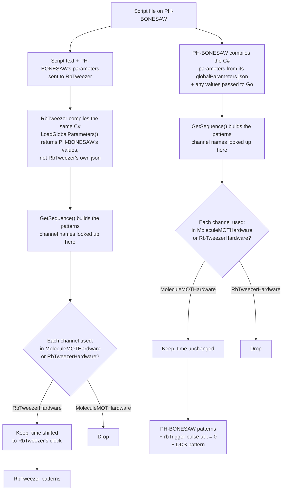
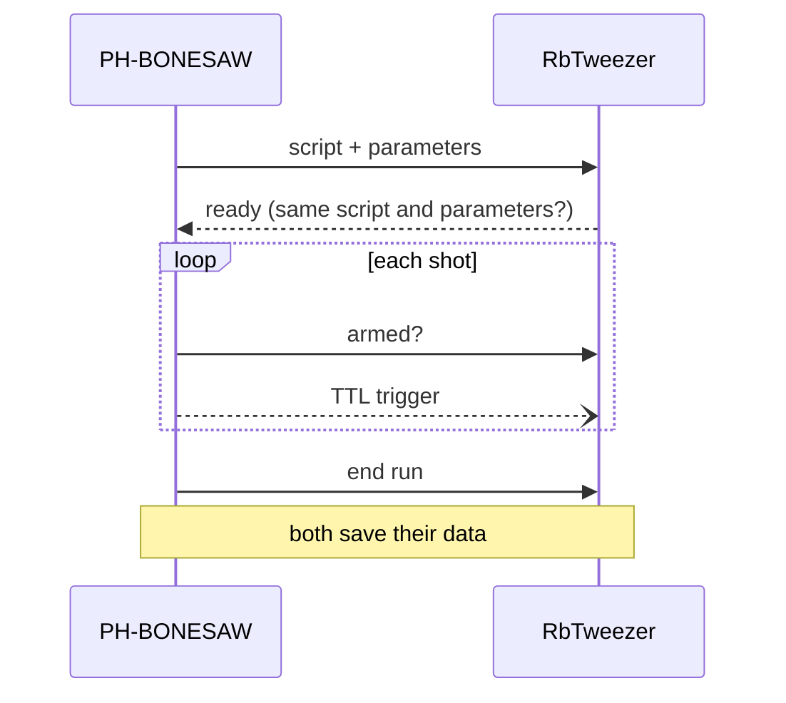

# Linked MOTMaster

One script runs on two machines. PH-BONESAW (primary) runs it as usual and triggers RbTweezer (secondary) with a TTL. Tick **Linked** on PH-BONESAW to turn it on.

## One script, two sets of patterns

**Compiling vs building.** These are two separate steps. In the script a channel is just a string, e.g. `p.Pulse(start, 0, duration, "tScopeTest")`, so the C# compiles on either machine whatever channels it uses. Channel names are only looked up when `GetSequence()` runs and builds the patterns. Without linked mode, PH-BONESAW fails at that point on an RbTweezer channel. With linked mode, it skips it.

**What gets compiled.** PH-BONESAW reads the script file once and sends that exact text, with its full parameter set, to RbTweezer. Both machines then compile and run the same `Patterns` class, each against its own build of MOTMaster and `DAQ.dll`. RbTweezer never uses its own `globalParameters.json` or a script file of its own. Before the run starts, each side hashes the script text and the parameters, and PH-BONESAW checks that the two sets of hashes match.

**Which channel belongs to which machine.** Each machine creates both Hardware classes: its own, and the other machine's, created only to read its channel list. Every `Pulse`, `AddEdge`, `AddAnalogValue`, ramp and so on in `GetSequence()` looks its channel name up in both lists. A machine keeps the event if the name is in its own Hardware class and drops it if the name is in the other one. So a channel name must be defined in exactly one of the two Hardware classes: `MoleculeMOTHardware` for CaF channels, `RbTweezerHardware` for Rb ones. The script itself doesn't say which machine a channel is on.

**Times.** Write every time as for a normal cafmot script: digital times from the pattern start, analog times from `DDS_Analog_Trg`. RbTweezer's clock starts when the trigger reaches it, `SecondaryTriggerDelay` ticks after PH-BONESAW's starts. It converts each kept event to its own clock, so an Rb event and a CaF event at the same script time happen together.

**Added automatically.** MOTMaster adds the `rbTrigger` pulse at t = 0, so scripts must not use that channel. The DDS pattern only runs on PH-BONESAW.

## How the two MOTMasters talk

All messages go over the network (.NET Remoting), except the trigger, which goes over a cable.
