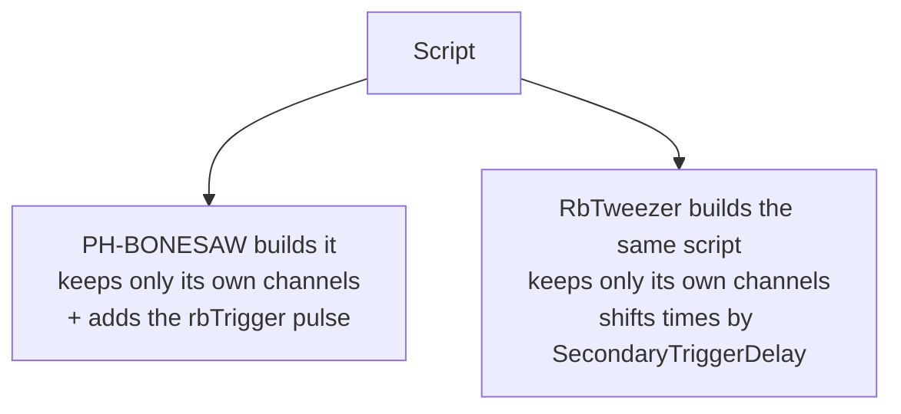
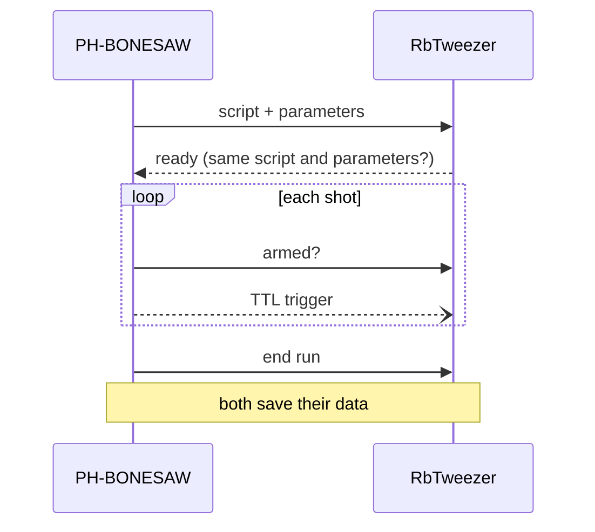

# Linked MOTMaster

One script runs on two machines. PH-BONESAW (primary) runs it as usual and triggers RbTweezer (secondary) with a TTL. Tick **Linked** on PH-BONESAW to turn it on.

## One script, two sets of patterns

Each channel name belongs to exactly one machine, which is how each side knows what to keep. Write all times as for a normal cafmot script.

## How the two MOTMasters talk

All messages go over the network (.NET Remoting), except the trigger, which goes over a cable.
