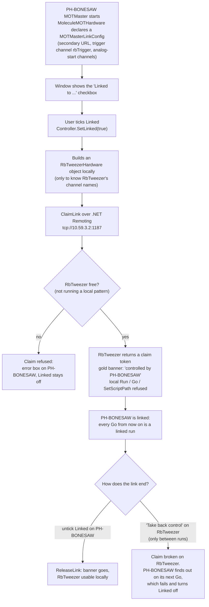
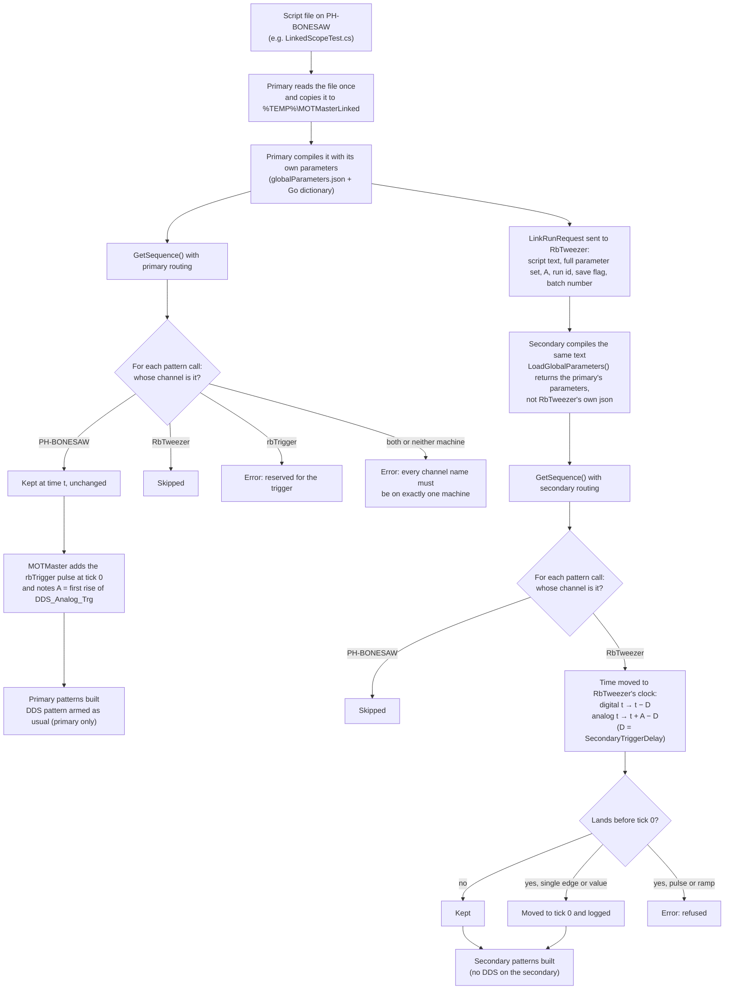
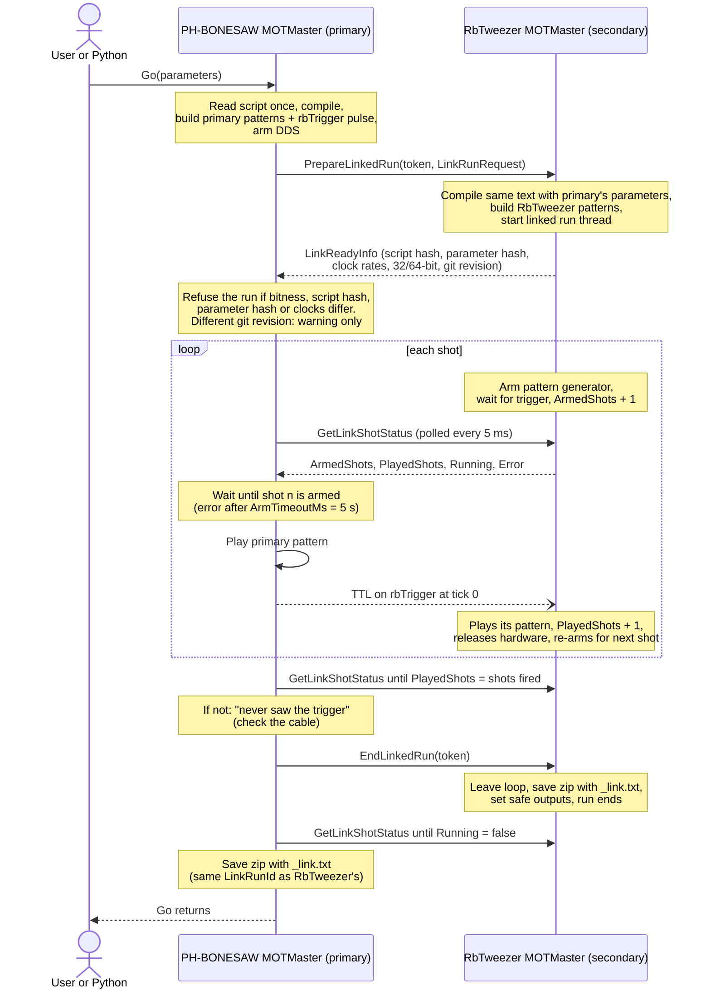
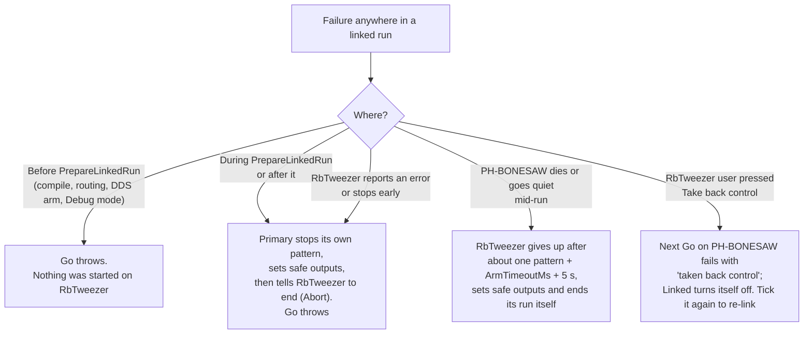

# Linked MOTMaster: how it works

Linked mode lets one MOTMaster script drive the pattern generators of two machines as if they were one experiment. The **primary** (PH-BONESAW, cafmot) runs the script as usual. The **secondary** (RbTweezer) builds its own part of the same script and plays it when the primary sends it a TTL trigger. You still run everything from the primary's window or from Python (`SetScriptPath` / `Go`). Nothing changes for any run with Linked unticked.

The diagrams below are Mermaid, which Obsidian, GitHub and VS Code's Markdown preview all render.

## 1. Linking the two MOTMasters

Linking happens once, before any runs. After that, every `Go` on the primary is a linked run until you untick Linked.

## 2. One script becomes patterns for both machines

Both machines compile the **same script text** and call the same `GetSequence()`. The difference is a routing context (`LinkRouting`) that is active while `GetSequence()` runs. Every `Pulse`, `AddEdge`, `AddAnalogValue`, ramp and so on asks it two questions: *is this channel mine?* and *what tick is this on my clock?* Channels belonging to the other machine are silently skipped, so each machine ends up with only its own channels.

### Times in the script

Write the script in the primary's times, exactly as for an unlinked cafmot script: digital times count from the pattern generator start, analog times from the `DDS_Analog_Trg` pulse. RbTweezer's tick 0 is when the trigger reaches it, `D` ticks after the primary starts. `D` is `SecondaryTriggerDelay` in `globalParameters.json` (General group), and you measure it with `LinkedScopeTest.cs` on a scope.

An example with `D = 3` and `DDS_Analog_Trg` first rising at primary tick `A = 2000`:

| Script says | Plays on PH-BONESAW at | Plays on RbTweezer at |
|---|---|---|
| digital CaF channel at 1000 | tick 1000 | – |
| digital Rb channel at 1000 | – | tick 997 (= 1000 − 3) |
| analog CaF channel at 50 | 50 ticks after `DDS_Analog_Trg` (tick 2050) | – |
| analog Rb channel at 50 | – | tick 2047 (= 50 + 2000 − 3) |

So an Rb event and a CaF event at the same script time happen at the same moment in the lab.

## 3. What happens on Go

This is a single `Go` with several shots. All the arrows between the two MOTMasters are .NET Remoting calls made by the primary. The only exception is the trigger, which is the TTL on `rbTrigger` wired to RbTweezer's `PGTriggerLine`. The secondary never calls the primary; the primary keeps polling it instead.

## 4. When something goes wrong

A linked run never fails quietly. Any failure throws out of `Go`: the GUI shows an error box and Python gets an exception. Errors from RbTweezer carry its own message across to PH-BONESAW.

## What a script needs to run linked

- At least one event on an RbTweezer channel. Otherwise linked mode refuses the run, since the script doesn't need it.
- At least one digital event on RbTweezer's master pattern board, so that RbTweezer's pattern has a clock.
- If there are RbTweezer analog events: a rising edge on `DDS_Analog_Trg` (or `aoPatternTrigger`) in the primary's pattern, which gives `A`.
- A `SecondaryTriggerDelay` parameter (cafmot's `globalParameters.json` already has one).
- No events on `rbTrigger`; MOTMaster drives it.
- No RbTweezer event that would start before RbTweezer is triggered: in practice no pulse or ramp in the first `D` ticks.

## More detail

- `.claude/skills/motmaster-linked-mode/SKILL.md` covers the code layout, files and builds.
- `docs/superpowers/specs/2026-10-22-linked-motmaster-design.md` is the design and the reasons behind it.
